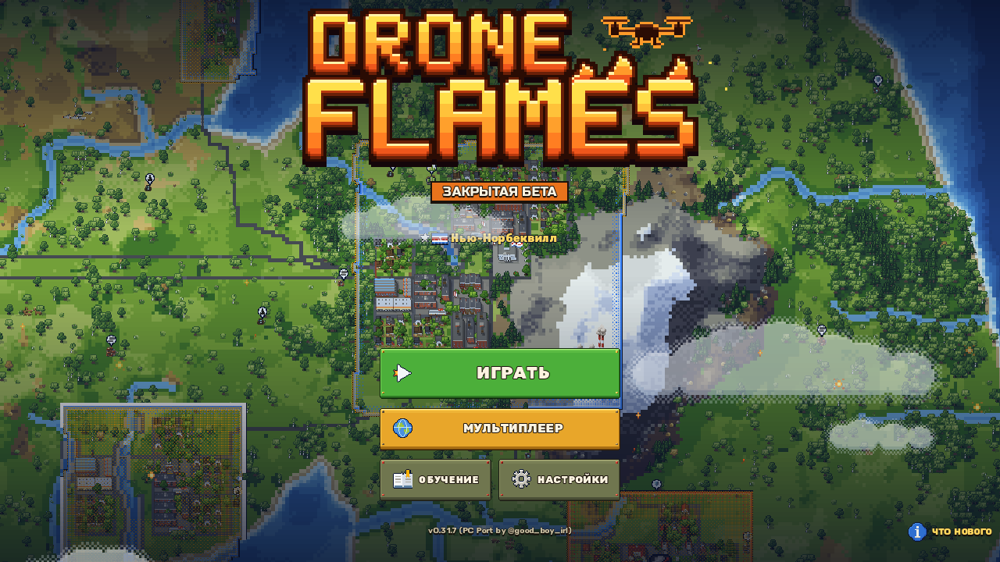
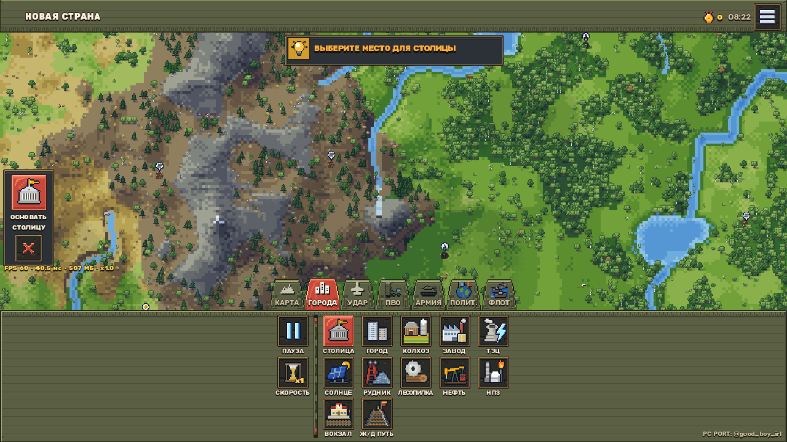

<p align="center">
  
</p>

<h1 align="center">🔥 DRONE FLAMES REBORN</h1>

<p align="center">
  <b>Та же война. Симуляция на Rust. Ноль фризов.</b><br>
  Возрождённая версия глобальной военной стратегии DroneFlames: тот же игровой мир и контент,
  но горячие пути симуляции перенесены в нативную библиотеку на Rust, а инженерная культура
  производительности стоит на первом месте.
</p>

<p align="center">
  
  
  
  
  
</p>

<p align="center">
  
  &nbsp;
  
</p>

---

## 📖 О проекте

**DroneFlames Reborn** — это наше видение того, какой должна быть эта игра.

Оригинальный разработчик DroneFlames — талантливый человек, который неустанно добавляет новый
функционал: флоты, дипломатию, железные дороги, ядерные удары, кампании. Но есть проблема,
которую он упорно не замечает: **без фундаментальной оптимизации в эту игру просто невозможно
играть**. На реальном бою симуляция проседает до единиц кадров в секунду — сотни юнитов,
десятки систем и тяжёлые пересчёты территорий убивают любой тактовый бюджет кадра.

Мы решили это исправить. Reborn — это тот же игровой мир, та же механика и тот же контент,
но с нативным ядром симуляции на Rust, пространственными индексами, кэшированием и
предсказуемым фреймтаймом. **Производительность — не настройка. Это архитектура.**

> ⚖️ Мы ни на что не претендуем: некоммерческий фанатский порт. Все права на оригинальную
> игру принадлежат её создателям. Подробности внизу страницы.

---

## 🦀 Как устроена производительность

Симуляция разделена на два слоя:

- **GDScript** — мир, приказы, эффекты (визуал, звук, урон), всё, что завязано на объекты сцены;
- **Rust (`df_native`, GDExtension)** — «математика войны»: массовые переборы юнитов, роли,
  разведка, баллистика, территории. Всё, что считает тысячи операций на кадр.

Паритет с GDScript-эталоном — **побитовый**: идентичный `Hash32`, та же f32-арифметика
`Vector2`, те же порядки обхода. Проверяется теневым режимом `DF_WD_VERIFY=1` прямо во время
боя (натив и GDScript считают одно решение, расхождения печатаются как ошибки — их ноль).

### Нативные пассы `df_native`

| Пасс | Что считает | Откуда |
|---|---|---|
| `acquire_one` / `valid_one` | поиск и перепроверка ближайшей цели по снапшоту + сетке 128px | `army.gd` |
| `spot_all` | «кто кого видит»: юниты и здания, дым, окопы, лимит 60 на страну | `army_fire.gd` |
| `smoke_at` | дым: круги операций + армейские эллипсы 16×9 | `army.gd` |
| `rockets_step` / `shells_step` | интегрирование полёта ракет и снарядов | `army.gd` |
| `aim_pick` | выбор арт-цели (плотность, дружественные рядом) | `army_fire.gd` |
| `occupy_candidates` | префильтр кандидатов в окопы | `army.gd` |
| `fight_decide` | ядро боя: перезарядка, попадания, промахи танков, гранаты, ПТРК, дым, подавление | `army.gd` |
| `wd_scan` | вывод войск: чья земля, вода/мосты, флоты, перемирия, списки юнитов пар | `operations.gd` |
| `spot_density` | плотность замеченных целей для арт-ИИ (сетка 45px) | `operations.gd` |

Без библиотеки (другая платформа, параноидальный антивирус) игра честно идёт по
GDScript-пути — поведение то же, только медленнее. Переключатели:
`DF_NO_NATIVE=1` (принудительный GDScript), `DF_WD_VERIFY=1` (теневая сверка).

---

## ⚡ Результаты

Stress-тест: headless-прогон боя, **250 юнитов на страну** (1000–1250 юнитов на карте),
мир 256×256, фиксированный сид (`--bench`). Замеры — встроенный профайлер `PERF PROBE`,
среднее по кадру в пике боя (первая минута).

| Метрика (пик боя) | Было (оригинал) | v1.0 (GDScript-оптимизации) | v1.0.5 (натив v3) | **v1.0.6 (натив v4)** |
|---|---:|---:|---:|---:|
| Кадр симуляции, всего | **285 мс** | **156 мс** | 143–149 мс | **101 мс** |
| `army.update` (юниты, бой) | 56.5 мс | 53.2 мс | 42–44 мс | **32.1 мс** |
| └ юнит-цикл | — | 34.7 мс | 25 мс | **11.3 мс** |
| └ поиск целей `_acquire` | O(n·сетка) каждые 0.25 с | стаггеринг ×2 | Rust, per-unit | **Rust-батч (1 вызов/тик)** |
| └ `fire` (бой + разведка) | — | — | 25.5 мс | **8.1 мс** |
| `ops.update` (операции) | 146.3 мс | 15.3 мс | ~15 мс | **5.5 мс** |
| └ `wd_tick` (вывод войск) | 142.1 мс | 6.7 мс | 6.5 мс | 2.4 мс |
| └ `wd_sweep` (скан земель) | — | 5.3 мс | Rust + приказы | Rust + приказы |
| Рендер-бэкенд по умолчанию | Mobile + D3D12 | gl_compatibility | gl_compatibility | gl_compatibility |

Колонка v1.0.6: стресс-сценарий `BENCH_HOME=1 BENCH_RAID=1 BENCH_FRONT=1`,
250 юнитов на страну, сид 424242, пик боя (первая минута). Чистый GDScript-путь
(`DF_NO_NATIVE=1`) на той же сцене: кадр 122 мс, `army.update` 54.6 мс,
юнит-цикл 19.2 мс — то есть натив v4 снимает ещё ~18% кадра и ~41% юнит-цикла.

> В headless-режиме (без GPU) стресс-тест держит 12–25 FPS вместо 3–5 у оригинала.
> На реальной машине запас больше: лёгкий gl_compatibility вместо D3D12 для 2D-стратегии.

### Что именно было сделано

**Нативное ядро (Rust, GDExtension).** Поиск целей, разведка, баллистика, ядро боевых
решений и скан территорий вынесены в `native/df_native` (godot-rust, api-4-7). Снапшот
юнитов + пространственная сетка 128px живут в нативе; GDScript передаёт только позиции
и флаги, получает готовые решения и исполняет эффекты.

**GDScript-оптимизации v1.0.** Кэш выхода к границе (спираль 320² → мемоизация 64px),
конвейерный `_wd_tick`, кластеризация армии за O(n), сетка плотности для артиллерии,
стаггеринг поиска целей, рендер по умолчанию `gl_compatibility`, встроенная инструментация
в PERF PROBE. Детали — в [docs/PERFORMANCE.md](docs/PERFORMANCE.md).

**Нативное ядро v4 (v1.0.6): батчи вместо per-unit вызовов.** `acquire_batch` —
валидация текущей цели и поиск новой для всех юнитов одним нативным вызовом за
scan-тик (было: до ~2×N вызовов `acquire_one`/`valid_one`); `spot_all_v2` — глаза
разведки (юниты/разведчики/города) строятся внутри Rust из снапшота, GDScript больше
не материализует ~N глаз-массивов; катера naval-высадок проверяются в том же пассе.
Паритет всех трёх новых путей (поиск целей, разведка, ядро боя, вывод войск, плотность)
проверен теневым режимом `DF_WD_VERIFY=1` — расхождений ноль, включая бит-в-бит
самопроверку `acquire_batch` против per-unit `acquire_one`.

**Инженерная инфраструктура.** Фиксированный сид бенчмарка (`--bench`, `DF_SEED`),
A/B-режим `DF_NO_NATIVE=1`, теневая верификация паритета `DF_WD_VERIFY=1`, CI собирает
Rust-библиотеку под Windows (static CRT) и macOS (universal через `lipo`).

---

## 🎮 Ключевые возможности

- **Полноценная глобальная стратегия**: экономика, логистика, железные дороги, флоты,
  дипломатия, альянсы, ядерные удары, ВДВ, разведка, ПВО
- **Армии на Rust + форсирование рек**: движение армий ведёт GDExtension `dfarmy`;
  спец-кнопка «ФОРСИРОВАНИЕ» — армия переправляется через реки вброд (медленно,
  остановить можно огнём); армии слушаются приказов и не убегают к казармам,
  десант больше не уплывает обратно и сразу идёт на штурм
- **Нативное ПК-управление**: WASD/стрелки, зум колесом, перетаскивание СКМ/ПКМ,
  горячие клавиши `1–7`, `B`/`T`, `F11` на полный экран, переназначение клавиш
- **Мультиплеер** (WebRTC Native): LAN и прямое подключение, комнаты, рейтинговые матчи,
  позднее подключение, реконнект и перенос хоста без остановки матча
- **Аккаунты, друзья и лобби-чат**: вход по логину/паролю, список друзей, сообщения,
  быстрый чат в лобби с модерацией хоста, профили игроков с косметикой и статистикой
- **Отказоустойчивая синхронизация**: матч не встаёт на время ресинка, плавное замедление
  вместо пауз, сжатие снапшотов и смотровая нить восстановления
- **Самохостинг relay-сервера**: свой `ws://`-сервер сигналов работает без WebRTC и
  без аккаунтов (`net/server/signal_server.gd`)
- **Моды**: `.dfmod`-пакеты, визуальный менеджер, локальная мастерская
- **Встроенный профайлер** `PERF PROBE`: FPS, время симуляции по системам, layer sweep
- **Автообновления** через GitHub Releases
- **118 предметов кастомизации**, Developer Mode разблокирован

---

## 🚀 Быстрый старт

### Скачать готовую сборку

Заберите последнюю сборку со страницы
[Releases](https://github.com/Illusivecup/drone_flames_PC-port_FPS_opt/releases) —
там Windows-инсталлятор и ZIP, macOS DMG/ZIP и Android APK.

GitHub качается медленно? Добавьте к любой ссылке на ассет префикс-прокси:

```text
https://gh-proxy.com/https://github.com/Illusivecup/.../releases/download/<tag>/<файл>
```

Запасные: `https://ghfast.top/`, `https://ghproxy.net/`. SHA-256 — в поле digest каждого ассета.

### Запуск из исходников (Godot 4.7.2)

```bash
git clone https://github.com/Illusivecup/drone_flames_PC-port_FPS_opt.git
cd drone_flames_PC-port_FPS_opt
# откройте папку в Godot 4.7.2 и нажмите F5
```

### Сборка нативного ядра (Rust)

```bash
cargo build --release --manifest-path native/df_native/Cargo.toml
# Linux: скопировать libdf_native.so в addons/df_native/bin/
```

CI делает это автоматически для Windows и macOS universal.

### Сборка пакетов

```bash
python3 build.py          # ZIP-архив + инсталлятор в dist/
```

### Стресс-тест производительности

```bash
godot --headless --path . -- --bench
# фикс. сид: DF_SEED=12345; чистый GDScript: DF_NO_NATIVE=1
# проверка паритета: DF_WD_VERIFY=1 (натив и GDScript считают одно решение)
# переменные: BENCH_UNITS=250, BENCH_HOME=1, BENCH_RAID=1, BENCH_FRONT=1
```

---

## 🗺️ Дорожная карта

| Версия | Фокус | Статус |
|---|---|---|
| **v1.0** | Горячие пути симуляции: вывод войск, поиск целей, ИИ, кластеризация, рендер-бэкенд | ✅ Выпущено |
| **v1.0.1** | Отказоустойчивый мультиплеер: матч не встаёт на ресинке, плавные удержания, самоспасение гостя | ✅ Выпущено |
| **v1.0.2–1.0.4** | Rust-ядро v1–v2: поиск целей, разведка, ракеты, снаряды, арт-выбор, окопы | ✅ Выпущено |
| **v1.0.5** | Rust-ядро v3: `fight_decide` (решения боя), `wd_scan` (вывод войск), `spot_density` (арт-ИИ), воспроизводимый бенчмарк | ✅ Выпущено |
| **v1.0.6** | Rust-ядро v4: `acquire_batch` (цели одним батчем за тик), `spot_all_v2` (глаза разведки в Rust), −18% кадра стресс-боя, −41% юнит-цикла | ✅ Выпущено |
| **v1.0.7** | Апдейт разраба v0.33.5.38 (аккаунты, друзья, лобби-чат, host migration) поверх Reborn; фикс установки встроенных модов из релизной сборки; фикс Reborn-бейджа на главном экране | ✅ Выпущено |
| v1.1 | Многопоточность симуляции (WorkerThreadPool), декомпозиция `menus.gd` | 🚧 В работе |
| v1.2 | Порты Linux-бинарей в релиз, батчинг спрайтов юнитов по зуму, GPU-частицы | 📋 План |
| v1.3 | Профилирование экономики и логистики, инкрементальный пересчёт территорий | 📋 План |

Принцип дорожной карты прост: **каждая новая функция обязана проходить FPS-бюджет**.
Новый контент не попадает в релиз, если на стресс-тесте он съедает больше 2 мс кадра.

---

## 📂 Структура репозитория

```text
drone_flames_PC-port_FPS_opt/
├── native/df_native/       # 🦀 Rust-ядро симуляции (godot-rust, GDExtension)
├── rust/dfarmy/            # 🦀 Rust-движок армий: степпинг, форсирование рек
├── addons/df_native/       # Подключение .gdextension + собранные бинарники
├── addons/dfarmy/          # Подключение dfarmy + собранные бинарники
├── assets/branding/        # Фирменные материалы Reborn
├── core/                   # Базовые подсистемы (моды, звук, палитра, клавиши)
├── dev/                    # Бенчмарки и dev-утилиты (--bench, --verify)
├── docs/                   # Инженерная документация (PERFORMANCE и др.)
├── game/                   # Симуляция: main, army, operations, экономика, ИИ
├── net/                    # Мультиплеер, аккаунты, автообновление
├── translations/           # Локализация (RU/EN/UK/ES)
├── ui/                     # HUD, меню, окна, косметика
├── world/                  # Генерация мира, слои рендера, шейдеры
├── build.py                # Сборка ZIP/инсталлятора
├── installer.iss           # Inno Setup
├── RELEASE_NOTES.md        # Тело текущего релиза (что сделано в этой версии)
├── project.godot           # Конфигурация Godot 4.7
└── README.md
```

---

## ⚖️ Дисклеймер

> **Мы ни на что не претендуем.** DroneFlames Reborn — некоммерческий фанатский проект,
> созданный энтузиастами ради любимой игры. Мы не связаны и не аффилированы с авторами
> и правообладателями оригинальной игры DroneFlames, не претендуем на их бренд, код,
> ассеты и прочую интеллектуальную собственность. Все права на оригинальную игру
> принадлежат её создателям. Если вы правообладатель и возражаете против существования
> этого проекта — напишите issue, мы всё уладим.

<p align="center">
  <sub>🔥 Reborn Team — играем, а не ждём загрузки кадра.</sub>
</p>
